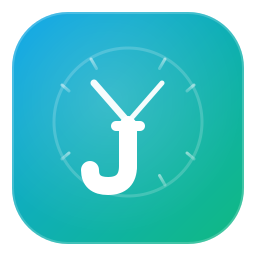

<div align="center">

<a href="https://s3ths1.github.io/jobify/">
  
</a>

<h1>Jobify</h1>

<h3>Event-loop-driven job scheduler for Python.</h3>

<p>
  Schedule jobs to run immediately, after a delay, at a specific time,
  or on a cron schedule - with second-level precision.
  No polling loops. SQLite persistence built in.
</p>

<p>Uses just <strong>~30 MB of RAM at idle</strong>.</p>

<p>
  <a href="https://pypi.org/project/jobify"><picture><source media="(prefers-color-scheme: dark)" srcset="https://shieldcn.dev/badge/dynamic/json.svg?url=https%3A%2F%2Fpypi.org%2Fpypi%2Fjobify%2Fjson&query=%24.info.version&variant=outline&font=geist&size=xs&mode=dark&logo=python&logoColor=3776AB&label=PyPI"></picture></a>
  <a href="https://pypi.org/project/jobify"><picture><source media="(prefers-color-scheme: dark)" srcset="https://shieldcn.dev/badge/Python-3.11%2B.svg?variant=outline&font=geist&size=xs&mode=dark&logo=python&logoColor=3776AB"></picture></a>
  <a href="https://github.com/s3ths1/jobify/blob/main/LICENSE"><picture><source media="(prefers-color-scheme: dark)" srcset="https://shieldcn.dev/github/s3ths1/jobify/license.svg?variant=outline&font=geist&size=xs&mode=dark"></picture></a>
<br>
  <a href="https://github.com/s3ths1/jobify/actions/workflows/pr_tests.yml"><picture><source media="(prefers-color-scheme: dark)" srcset="https://shieldcn.dev/github/ci/s3ths1/jobify.svg?workflow=pr_tests.yml&branch=main&variant=outline&font=geist&size=xs&mode=dark&label=Tests"></picture></a>
  <a href="https://github.com/s3ths1/jobify/actions/workflows/pr_codeql.yml"><picture><source media="(prefers-color-scheme: dark)" srcset="https://shieldcn.dev/github/ci/s3ths1/jobify.svg?workflow=pr_codeql.yml&branch=main&variant=outline&font=geist&size=xs&mode=dark&label=CodeQL"></picture></a>
  <a href="https://github.com/s3ths1/jobify/actions/workflows/pr_dependency_review.yml"><picture><source media="(prefers-color-scheme: dark)" srcset="https://shieldcn.dev/github/ci/s3ths1/jobify.svg?workflow=pr_dependency_review.yml&variant=outline&font=geist&size=xs&mode=dark&label=Dependency+Review"></picture></a>
  <a href="https://codspeed.io/s3ths1/jobify?utm_source=badge"><picture><source media="(prefers-color-scheme: dark)" srcset="https://shieldcn.dev/badge/CodSpeed-benchmarked.svg?variant=outline&font=geist&size=xs&mode=dark"></picture></a>
  <a href="https://t.me/jobify_community"><picture><source media="(prefers-color-scheme: dark)" srcset="https://shieldcn.dev/badge/Telegram-Join%20chat.svg?variant=outline&font=geist&size=xs&mode=dark&logo=telegram&logoColor=24A1DE"></picture></a>
<br>
  <a href="https://coverage-badge.samuelcolvin.workers.dev/redirect/s3ths1/jobify"></a>
</p>

[Documentation](https://s3ths1.github.io/jobify/) ·
[Quick Start](#quick-start) ·
[Comparison](https://s3ths1.github.io/jobify/#comparison) ·
[Community Extensions](https://github.com/Jobify-Community)

</div>

## Contents

- [Why Jobify](#why-jobify)
- [Installation](#installation)
- [Quick Start](#quick-start)
- [Key Features](#key-features)
- [When to Choose Jobify](#when-to-choose-jobify)
- [Roadmap](https://github.com/s3ths1/jobify/issues/107)
- [License](#license)

## Why Jobify

Most Python schedulers rely on polling loops. Jobify uses low-level `asyncio` timers (`call_at`) to schedule jobs directly.

- **No idle polling CPU cost**
- **Sub-millisecond trigger precision**
- **Native async-first execution model**

If your workload is bursty or downstream services are sensitive, use [Queue Middleware](https://s3ths1.github.io/jobify/advanced_usage/queue/) to add bounded buffering, backpressure, and priority routing.

## Installation

```bash
pip install jobify
```

## Quick Start

```python
import asyncio

from jobify import Jobify, Job

app = Jobify()


@app.task
async def hello(name: str) -> None:
    print(f"Hello, {name}")


async def main() -> None:
    async with app:
        job: Job = await hello.push("Alex")
        await job.wait()

if __name__ == "__main__":
    asyncio.run(main())
```

<details>
<summary>Extended example (cron, delay, absolute time)</summary>

```python linenums="1" hl_lines="31-32"
import asyncio
from datetime import datetime, timedelta
from zoneinfo import ZoneInfo

from jobify import Jobify, Job

UTC = ZoneInfo("UTC")
app = Jobify(tz=UTC)


@app.task(cron="* * * * * * *")  # every second
async def my_cron() -> None:
    print("cron tick")


@app.task
def my_job(name: str) -> None:
    now = datetime.now(tz=UTC)
    print(f"Hello, {name}! at {now!r}")


async def main() -> None:
    async with app:
        await my_job.push("Alex")

        run_next_day = datetime.now(tz=UTC) + timedelta(days=1)
        job_at: Job = await my_job.schedule("Connor").at(run_next_day)
        job_delay: Job = await my_job.schedule("Sara").delay(20)
        job_cron: Job = await my_cron.schedule().cron("* * * * *", job_id="dynamic_cron_id")

        # block until every scheduled job is done
        await app.wait_all()


if __name__ == "__main__":
    asyncio.run(main())
```

### Waiting for jobs

Jobify provides two ways to wait for job execution:

* `await job.wait()` - waits for a specific job to reach a terminal state.
* `await app.wait_all()` - wait until every scheduled job has finished (statuses SUCCESS, FAILED or TIMEOUT). The call returns as soon as the internal jobs registry becomes empty.

This is the simplest way to keep your process alive until the background work is complete, eliminating the need for `while True: sleep()` loops and manual result tracking.

</details>

## Key Features

- [**Precision scheduling**](https://s3ths1.github.io/jobify/#why-jobify): event-driven timers, no polling loop.
- [**Flexible triggers**](https://s3ths1.github.io/jobify/schedule/): now, delay, timestamp, cron.
- [**Persistence**](https://s3ths1.github.io/jobify/app_settings/#storage): built-in SQLite storage for scheduled jobs.
- [**Routing**](https://s3ths1.github.io/jobify/router/): organize tasks with `JobRouter`.
- [**Context injection**](https://s3ths1.github.io/jobify/context/): inject state and dependencies into tasks.
- [**Middleware pipeline**](https://s3ths1.github.io/jobify/app_settings/#middleware): execution and scheduling interceptors.
- [**Queue middleware**](https://s3ths1.github.io/jobify/advanced_usage/queue/): FIFO/LIFO/PriorityQueue with backpressure.
- [**Exception handlers**](https://s3ths1.github.io/jobify/advanced_usage/exception_handlers/): hierarchical error handling.
- [**Run modes**](https://s3ths1.github.io/jobify/task_settings/#run_mode): `asyncio`, thread pool, process pool.
- [**Community DB adapters**](https://github.com/Jobify-Community/jobify-db).

<details>
<summary>Feature comparison (Jobify vs Taskiq/APScheduler/Celery)</summary>

| Feature name                                                                                    |        Jobify        |      Taskiq       | APScheduler (v3) |      Celery       |
| :---------------------------------------------------------------------------------------------- | :------------------: | :---------------: | :--------------: | :---------------: |
| **Event-driven Scheduling**                                                                     | ✅ (Low-level timer) | ❌ (Polling/Loop) |  ❌ (Interval)   | ❌ (Polling/Loop) |
| **Async Native (asyncio)**                                                                      |          ✅          |        ✅         | ❌ (Sync mostly) |        ❌         |
| [**Context Injection**](https://s3ths1.github.io/jobify/context/)                            |          ✅          |        ✅         |        ❌        |        ❌         |
| [**FastAPI-style Routing**](https://s3ths1.github.io/jobify/router/)                         |          ✅          |        ❌         |        ❌        |        ❌         |
| [**Middleware Support**](https://s3ths1.github.io/jobify/app_settings/#middleware)           |          ✅          |        ✅         | ❌ (Events only) |   ❌ (Signals)    |
| [**Lifespan Support**](https://s3ths1.github.io/jobify/app_settings/#lifespan)               |          ✅          |        ✅         |        ❌        |        ❌         |
| [**Exception Handlers**](https://s3ths1.github.io/jobify/advanced_usage/exception_handlers/) |  ✅ (Hierarchical)   |        ❌         |        ❌        |        ❌         |
| [**Job Cancellation**](https://s3ths1.github.io/jobify/job/#await-jobcancel)                 |          ✅          |        ❌         |        ✅        |        ✅         |
| [**Cron Scheduling**](https://s3ths1.github.io/jobify/schedule/#cron-expressions)            |  ✅ (Seconds level)  |   ✅ (Minutes)    |        ✅        |        ✅         |
| [**Misfire Policy**](https://s3ths1.github.io/jobify/schedule/#the-cron-object)              |          ✅          |        ❌         |        ✅        |        ❌         |
| [**Run Modes (Thread/Process)**](https://s3ths1.github.io/jobify/task_settings/#run_mode)    |          ✅          |        ✅         |        ✅        |        ✅         |
| **Zero-config Persistence**                                                                     | ✅ (SQLite default)  | ❌ (Needs Broker) |        ✅        | ❌ (Needs Broker) |
| **Broker-backend execution**                                                                    |     ❌ (roadmap)     |        ✅         |        ❌        |        ✅         |

</details>

## When to Choose Jobify

Use Jobify when:

- you need precise in-process scheduling without polling overhead
- you want typed, framework-like APIs for task registration and routing
- you need queue-based backpressure and priority controls in a single process

## License

This project is licensed under the [MIT license](https://github.com/s3ths1/jobify/blob/main/LICENSE).
